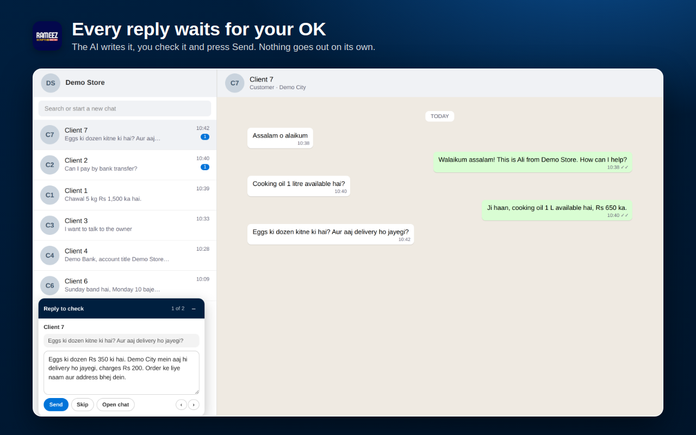
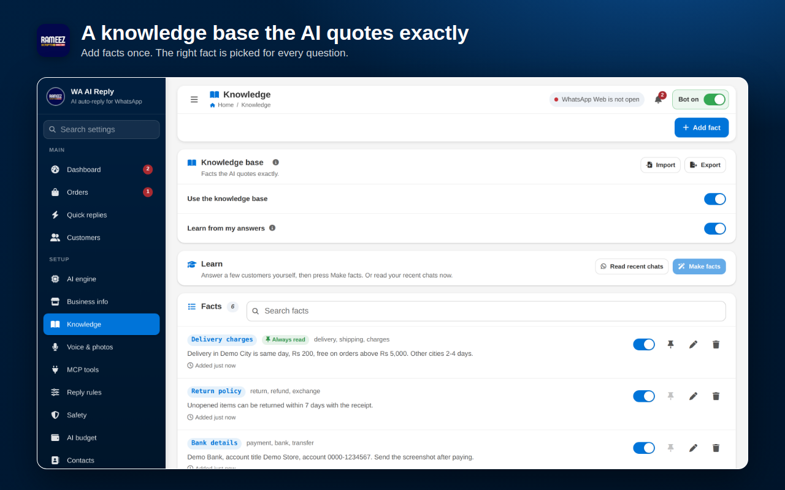

# WA AI Reply - AI Auto Reply Chrome Extension for WhatsApp Web

**WA AI Reply** is a Chrome extension that writes AI replies to your customer messages on WhatsApp Web. It uses Claude, ChatGPT, Gemini or Grok with your own API key, answers from your own business information, and puts every reply in front of you to check before it is sent.

Built for shops, clinics, restaurants, online stores, salons, property dealers, travel agents and any business that answers the same customer questions on WhatsApp every day.

## Download

**[Download wa-ai-reply-v1.12.0.zip](https://github.com/rameezimdad/WA-AI-Reply/releases/latest/download/wa-ai-reply-v1.12.0.zip)**

The extension needs a **licence key** to work. One key works on one computer. Get your key on WhatsApp: https://wa.me/923435347417

## Features

| Feature | What it does |
|---|---|
| AI replies you approve | The AI writes the reply, you check or edit it and press Send |
| Your own AI | Claude, ChatGPT, Gemini or Grok with your own API key, or your own server |
| Business info | Products, prices, timings, delivery, payment and returns, 22 business types ready |
| Knowledge base | Facts the AI quotes exactly, with "always read" pins and learning from your answers |
| Any language | Replies in the customer's language: English, Urdu, Roman Urdu, Arabic, Hindi and more |
| Voice notes and photos | Understands voice notes and pictures customers send |
| Quick replies | Price lists, bank details, location and files, sent when a customer asks |
| Customer memory | Notes, tags and language per customer, read before every reply |
| Orders | Picks up orders from the chat and can send them to your Google Sheet |
| MCP tools | Connect your own tools so the AI can check stock, bookings or order status |
| Safety | Daily limits, working hours, opt-out words, a person takes over when asked |
| AI budget | Monthly spending limit for your AI key |
| Dashboard | Today's replies, chats that need you, new orders and AI cost |

## Screenshots

| | |
|---|---|
|  |  |
|  |  |
|  |  |

## Install step by step

You need Google Chrome (or Microsoft Edge, Brave or any Chromium browser) on a computer. It does not work on phones.

**Step 1 - Download the zip**
Click the download link above. The file `wa-ai-reply-v1.12.0.zip` lands in your Downloads folder.

**Step 2 - Extract it to a folder you will keep**
Right-click the zip and choose **Extract All**. Move the extracted folder somewhere safe, for example `D:\WA AI Reply`.
Do not delete this folder later. Chrome runs the extension from it.

**Step 3 - Open the Extensions page**
In Chrome, type `chrome://extensions` in the address bar and press Enter.

**Step 4 - Turn on Developer mode**
Switch on **Developer mode** at the top right of the Extensions page.

**Step 5 - Load the extension**
Click **Load unpacked** and select the extracted folder (the one that has `manifest.json` inside). WA AI Reply now shows in the list.

**Step 6 - Pin it**
Click the puzzle icon next to the address bar and click the pin next to **WA AI Reply**, so its icon stays on the toolbar.

## Set up step by step

**Step 7 - Activate your licence key**
The settings page opens on the **License** page. Paste your key (it looks like `WAAI-XXXX-XXXX-XXXX-XXXX`) and press **Activate**.
No key yet? Message us on WhatsApp: https://wa.me/923435347417

**Step 8 - Add your AI key**
Open **AI engine**, pick a provider and paste its API key:

| Provider | Where to get the key |
|---|---|
| Gemini (has a free tier) | https://aistudio.google.com/apikey |
| Claude | https://console.anthropic.com/settings/keys |
| ChatGPT | https://platform.openai.com/api-keys |
| Grok | https://console.x.ai |

The key stays on your computer and is only sent to the provider you picked.

**Step 9 - Tell the AI about your business**
Open **Business info**, choose your business type and fill in your products, prices, timings, delivery and payment details. Add more facts in **Knowledge** if you like.

**Step 10 - Try it first**
Open **Test the AI** and type a question the way a customer would, for example `delivery kitne din mein hoti hai?`. Nothing is sent to WhatsApp from this page. Change your business info until the answers look right.

**Step 11 - Open WhatsApp Web**
Click **Open WhatsApp** (or go to https://web.whatsapp.com) and log in by scanning the QR code with your phone. A button shows at the bottom left: click it so it reads **AI Reply ON**.

**Step 12 - Check and send**
When a customer writes, the AI's reply appears in the **Reply to check** panel at the bottom left. Edit it if needed, then press **Send**, or **Skip** to leave it.

## Update to a new version

1. Download the new zip from [Releases](https://github.com/rameezimdad/WA-AI-Reply/releases).
2. Extract it **into the same folder** as before and replace the old files.
3. Open `chrome://extensions` and click the reload arrow on WA AI Reply.
4. Reload the WhatsApp Web tab.

Keep the same folder. If you load it from a new folder, Chrome treats it as a new extension and your settings start empty. To move it, download a backup first: **Help > Health > Backup and restore > Download**, then restore it in the new install.

## Move to another computer

Open the **License** page and press **Release** to free the key from this computer. Download a backup from **Help > Health > Backup and restore**, install the extension on the new computer, restore the backup and activate the same key.

## Troubleshooting

| You see | Do this |
|---|---|
| The extension is locked | Open **License** and activate a valid key, or ask the seller to renew it |
| `AI Reply: reload this tab` | The extension was updated. Reload the WhatsApp Web tab |
| `AI Reply: log in first` | Scan the QR code in WhatsApp Web |
| `AI Reply: not connected` | Wait for WhatsApp Web to finish loading, then click the button |
| No replies coming | Check that **Bot on** is switched on, your AI key is added, and today's limit is not used up |
| AI key error | Open **Test the AI** and send a question; if it fails, check the key in **AI engine** and that it has credit |

## FAQ

**How do I auto reply on WhatsApp Web with AI?**
Install WA AI Reply, activate your licence key, add an AI key and your business info, then open WhatsApp Web and turn AI Reply on. The AI writes a reply to every new customer message and you press Send.

**Does it send messages without me?**
No. Every reply waits in the review panel until you press Send. Only the quick replies you choose can go out on their own, and only to the numbers you list.

**Which AI does it use?**
Your choice: Claude, ChatGPT, Gemini or Grok, with your own API key. Gemini has a free tier.

**Can it reply in Urdu or Roman Urdu?**
Yes. It replies in the language the customer writes in, or in the language you set for that customer.

**Is my chat data sold or stored on your server?**
No. Settings, chats and customer notes stay in your browser. Messages go only to the AI provider you picked. The licence server sees only your licence key and a random device code. Read the [privacy policy](https://license.rameezscripts.com/privacy/).

**Does it work on WhatsApp Business?**
It works with any account you open in WhatsApp Web, including WhatsApp Business accounts.

**Can I use one key on two computers?**
No. One key works on one computer. Release it on the License page to move it.

## Disclaimer

WA AI Reply is not made by, or connected with, WhatsApp or Meta. It is an unofficial tool. Use it only to reply to people who message you, and follow WhatsApp's Terms of Service.

## Let's Work Together

Need a licence key, a custom feature or a custom software for your business?

- WhatsApp: https://wa.me/923435347417
- Email: Contact@rameezscripts.com

Developed by Mohammad Rameez Imdad (Rameez Scripts)
YouTube: https://www.youtube.com/@rameezimdad
Website: https://rameezscripts.com
