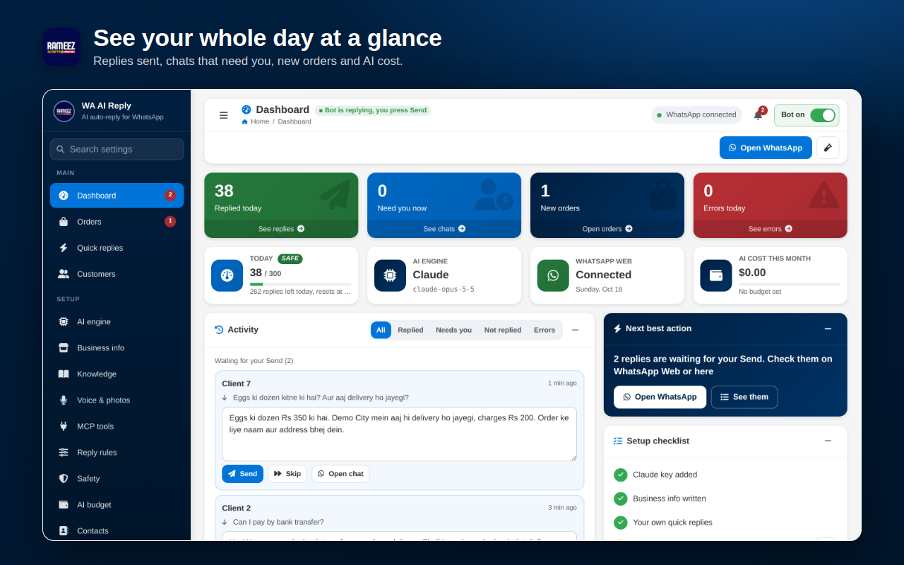
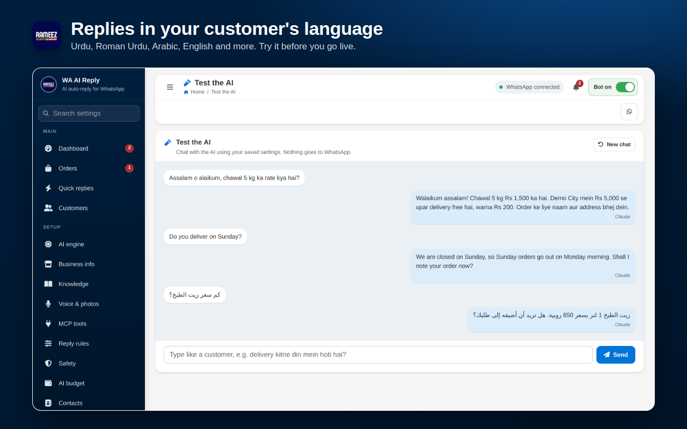
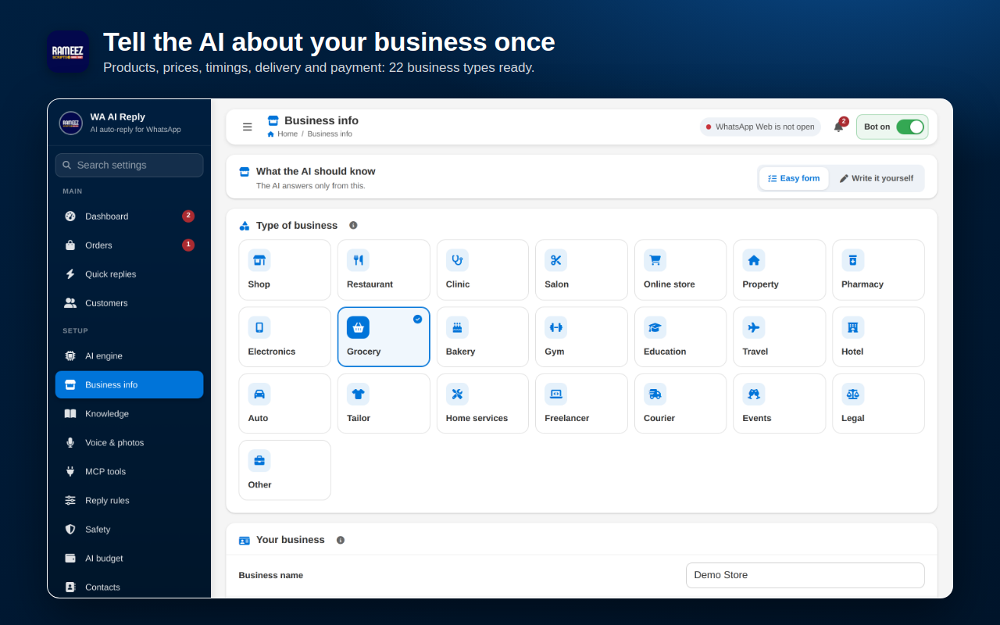
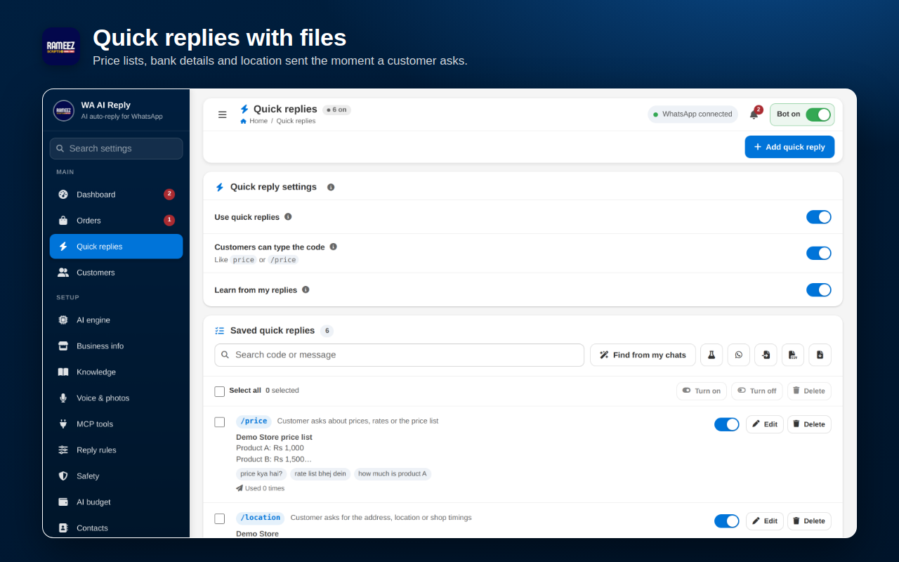
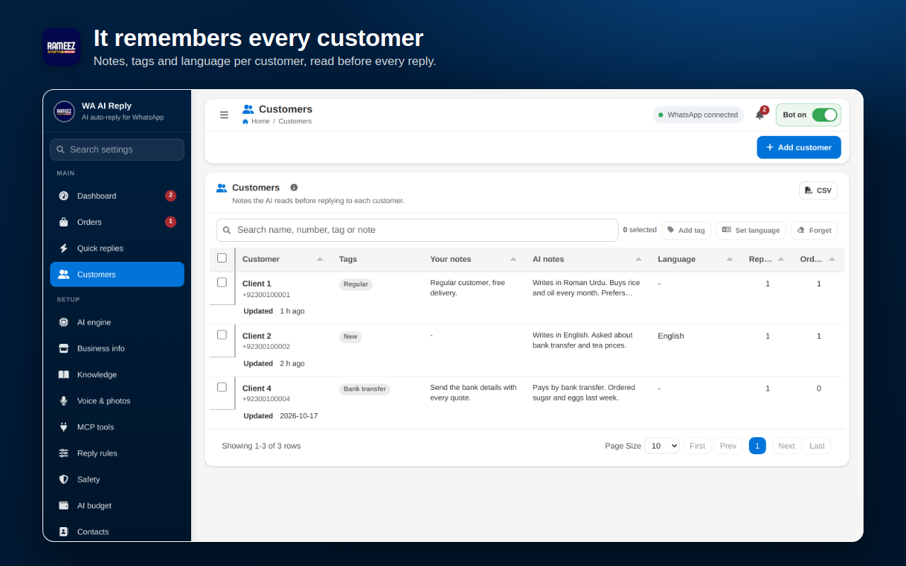

# WhatsApp AI Auto Reply Chrome Extension (WA AI Reply)

**WA AI Reply** is a WhatsApp AI auto reply Chrome extension for WhatsApp Web. ChatGPT, Claude, Gemini or Grok writes replies to your customer messages from your own business info, and you check every reply before you press Send. An AI chatbot for business that works inside the WhatsApp Web you already use: no new number and no WhatsApp Business API needed.

Built for shops, clinics, restaurants, online stores, salons, property dealers, travel agents and any business that answers the same customer questions on WhatsApp every day.

## Download

**[Download wa-ai-reply-v1.17.0.zip](https://github.com/rameezimdad/whatsapp-ai-auto-reply-chrome-extension/releases/latest/download/wa-ai-reply-v1.17.0.zip)** (Chrome, Edge, Brave on Windows, macOS, Linux)

The extension needs a **licence key** to work. One key works on one computer. Get your key on WhatsApp: https://wa.me/923435347417

Website: https://rameezscripts.com/wa-ai-reply.php

## Contents

- [How the WhatsApp AI auto reply works](#how-the-whatsapp-ai-auto-reply-works)
- [Features](#features)
- [Screenshots](#screenshots)
- [Install step by step](#install-step-by-step)
- [Set up step by step](#set-up-step-by-step)
- [Auto update (Windows)](#auto-update-windows)
- [Update to a new version by hand](#update-to-a-new-version-by-hand)
- [Troubleshooting](#troubleshooting)
- [FAQ](#faq)

## How the WhatsApp AI auto reply works

1. **A customer writes** on WhatsApp: a text, a voice note or a photo, in any language.
2. **The AI writes the reply** from your business info, your knowledge base and what it remembers about that customer.
3. **You check and send.** The reply waits in a small panel on WhatsApp Web. Edit it if you like, then press Send or Skip.

## Features

| Feature | What it does |
|---|---|
| AI replies you approve | The AI writes the reply, you check or edit it and press Send |
| ChatGPT, Claude, Gemini, Grok | Use your own API key, or your own server |
| Business info | Products, prices, timings, delivery, payment and returns, 22 business types ready |
| Knowledge base | Facts the AI quotes exactly, with "always read" pins and learning from your answers |
| Any language | Replies in Urdu, Roman Urdu, Arabic, Hindi, English and more |
| Voice notes and photos | Understands voice notes and pictures customers send |
| Quick replies with files | Price lists, bank details, location and PDFs, sent when a customer asks |
| Customer memory | Notes, tags and language per customer, read before every reply (a light WhatsApp CRM) |
| Appointments | Set your free times once; the AI offers them, books the appointment and reminds the customer the day before |
| Orders | Picks up orders from the chat and sends them to your Google Sheet |
| MCP tools | The AI can check live stock, bookings or order status from your own system |
| Safety limits | Daily limits, working hours, opt-out words, a person takes over when asked |
| AI budget | Monthly spending limit for your AI key |
| Dashboard | Today's replies, chats that need you, new orders and AI cost |

## Screenshots

| | |
|---|---|
|  |  |
|  |  |
|  |  |

All screenshots use demo data.

## Install step by step

You need Google Chrome (or Microsoft Edge, Brave or any Chromium browser) on a computer. It does not work on phones.

**Step 1 - Download the zip**
Click the download link above. The file `wa-ai-reply-v1.17.0.zip` lands in your Downloads folder.

**Step 2 - Extract it to a folder you will keep**
Right-click the zip and choose **Extract All**. Move the extracted folder somewhere safe, for example `D:\WA AI Reply`.
Do not delete this folder later. Chrome runs the extension from it.

**Step 3 - Open the Extensions page**
In Chrome, type `chrome://extensions` in the address bar and press Enter.

**Step 4 - Turn on Developer mode**
Switch on **Developer mode** at the top right of the Extensions page.

**Step 5 - Load the extension**
Click **Load unpacked** and select the extracted folder (the one that has `manifest.json` inside). WA AI Reply now shows in the list.

**Step 6 - Pin it**
Click the puzzle icon next to the address bar and click the pin next to **WA AI Reply**, so its icon stays on the toolbar.

## Set up step by step

**Step 7 - Activate your licence key**
The settings page opens on the **License** page. Paste your key (it looks like `WAAI-XXXX-XXXX-XXXX-XXXX`) and press **Activate**.
No key yet? Message us on WhatsApp: https://wa.me/923435347417

**Step 8 - Add your AI key**
Open **AI engine**, pick a provider and paste its API key:

| Provider | Where to get the key |
|---|---|
| Gemini (has a free tier) | https://aistudio.google.com/apikey |
| Claude | https://console.anthropic.com/settings/keys |
| ChatGPT | https://platform.openai.com/api-keys |
| Grok | https://console.x.ai |

The key stays on your computer and is only sent to the provider you picked.

**Step 9 - Tell the AI about your business**
Open **Business info** (or the setup steps) and press **Fill from my WhatsApp**: it reads your WhatsApp Business profile, catalog and your own replies and fills the boxes. Check them and fix anything wrong. **Demo data** fills a sample business for testing. Add more facts in **Knowledge** if you like.

**Step 10 - Try it first**
Open **Test the AI** and type a question the way a customer would, for example `delivery kitne din mein hoti hai?`. Nothing is sent to WhatsApp from this page. Change your business info until the answers look right.

**Step 11 - Open WhatsApp Web**
Click **Open WhatsApp** (or go to https://web.whatsapp.com) and log in by scanning the QR code with your phone. A button shows at the bottom left: click it so it reads **AI Reply ON**.

**Step 12 - Check and send**
When a customer writes, the AI's reply appears in the **Reply to check** panel at the bottom left. Edit it if needed, then press **Send**, or **Skip** to leave it.

## Auto update (Windows)

Turn it on once and every new version installs itself. Your settings, orders and customers stay.

1. Open the WA AI Reply folder (for example `D:\WA AI Reply`), then the `updater` folder.
2. Double-click **Turn on auto update.bat**. If Windows shows "Windows protected your PC", click **More info** and then **Run anyway**.
3. A window says **Auto update is ON**. Close it.

What happens after that:

- Every 6 hours the computer checks this page for a new release, downloads the zip, checks its SHA256 and puts the new files in the same folder. Files the new version no longer needs are removed. You never download anything yourself.
- WA AI Reply reloads itself when no reply is waiting or being written and you have not used WhatsApp Web for a minute, then reloads the WhatsApp Web tab. Nothing is lost.
- You can see the status in the extension under **Updates** page in the sidebar.
- To stop it, double-click **Turn off auto update.bat** in the same folder.

Auto update comes with version 1.12.2. If you have an older version, update by hand once (below), then turn it on.

## Update to a new version by hand

1. Download the new zip from [Releases](https://github.com/rameezimdad/whatsapp-ai-auto-reply-chrome-extension/releases).
2. Extract it **into the same folder** as before and replace the old files.
3. Open `chrome://extensions` and click the reload arrow on WA AI Reply.
4. Reload the WhatsApp Web tab.

Keep the same folder. If you load it from a new folder, Chrome treats it as a new extension and your settings start empty. To move it, download a backup first: **Help > Health > Backup and restore > Download**, then restore it in the new install.

## Move to another computer

Open the **License** page and press **Release** to free the key from this computer. Download a backup from **Help > Health > Backup and restore**, install the extension on the new computer, restore the backup and activate the same key.

## Troubleshooting

| You see | Do this |
|---|---|
| The extension is locked | Open **License** and activate a valid key, or ask the seller to renew it |
| `AI Reply: reload this tab` | The extension was updated. Reload the WhatsApp Web tab |
| `AI Reply: log in first` | Scan the QR code in WhatsApp Web |
| `AI Reply: not connected` | Wait for WhatsApp Web to finish loading, then click the button |
| No replies coming | Check that **Bot on** is switched on, your AI key is added, and today's limit is not used up |
| AI key error | Open **Test the AI** and send a question; if it fails, check the key in **AI engine** and that it has credit |

## FAQ

**How do I auto reply to WhatsApp messages with AI?**
Install WA AI Reply in Chrome, activate your licence key, add an AI key and your business info, then open WhatsApp Web and turn AI Reply on. The AI writes a reply to each new customer message and you press Send.

**Can I use ChatGPT for WhatsApp auto reply?**
Yes. Pick ChatGPT in AI engine and paste your OpenAI API key. Claude, Gemini and Grok work the same way.

**Does it work with WhatsApp Business?**
Yes. It works with any account you open in WhatsApp Web, including WhatsApp Business accounts.

**Is it a WhatsApp AI chatbot or AI agent?**
It works like an AI agent for your WhatsApp: it answers from your business info and knowledge base, remembers each customer, takes orders and can check live data through MCP tools. By default you approve every reply before it goes out.

**Does it send messages without me?**
Not by default. Every AI reply waits in the review panel until you press Send. Saved quick replies can go by themselves only to the numbers you list.

**Can it reply in Urdu or Roman Urdu?**
Yes. It replies in the language the customer writes in, or in the language you set for that customer.

**Can I use Gemini for free?**
Google gives a free tier for Gemini API keys at https://aistudio.google.com/apikey. The extension itself needs a paid licence key.

**Is my chat data sold or stored on your server?**
No. Settings, chats and customer notes stay in your browser. Messages go only to the AI provider you picked. The licence server sees only your licence key and a random device code. Read the [privacy policy](https://license.rameezscripts.com/privacy/).

**How do I install a Chrome extension from a zip file?**
Extract the zip to a folder, open `chrome://extensions`, turn on Developer mode, click **Load unpacked** and select the folder that has `manifest.json` inside.

**Can I use one key on two computers?**
No. One key works on one computer. Release it on the License page to move it.

## Disclaimer

WA AI Reply is not made by, or connected with, WhatsApp or Meta. It is an unofficial tool. Use it only to reply to people who message you, and follow WhatsApp's Terms of Service.

## Let's Work Together

Need a licence key, a custom feature or custom software for your business?

- WhatsApp: https://wa.me/923435347417
- Email: Contact@rameezscripts.com

Developed by Mohammad Rameez Imdad (Rameez Scripts)
YouTube: https://www.youtube.com/@rameezimdad
Website: https://rameezscripts.com
